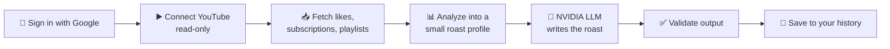

<div align="center">


# TubeRoast

**Your YouTube taste, roasted. 🔥**

Connect your Google account, let TubeRoast read the YouTube data Google allows, and get a personalized, good-natured roast written by an LLM.

<a href="https://tube-roast.onrender.com"></a>


<br />


</div>

---

> [!NOTE]
> 🧪 The Google app is in **Testing** mode, so only accounts added as test users can sign in.
> 💤 The free hosting tier sleeps after 15 minutes without visitors; the first visit after that can take up to a minute to load.

## ✨ Features

- 🔐 **Sign in with Google**: only your name and profile picture are requested.
- ▶️ **Read-only YouTube connection**: a separate, optional consent step you can revoke at any time.
- 📊 **Taste analysis**: top channels, categories, topics, keywords, video length, playlists and fun "traits", computed with deterministic, unit-tested code.
- 🤖 **AI-written roasts**: a hosted LLM turns that summary into a roast with a headline and a verdict.
- 👀 **"What the AI will see"**: see exactly what is sent to the model before you roast.
- 🗂️ **Roast history**: your 20 latest roasts, with copy and delete.
- 🎬 **YouTube-inspired UI**: dark theme, video-style cards, smooth Motion animations, responsive from 320 px phones to desktops, and keyboard accessible.

## 🔄 How a roast is made



The app does the analysis; the LLM only writes the jokes. It is an existing general-purpose model, not a custom-trained one.

## 🛡️ What data TubeRoast uses

| Step | What happens |
| ---- | ------------ |
| 🔐 **Signing in** | Asks Google only for `openid profile`. Stores your Google account ID, name and avatar URL. **No email, no Google tokens.** |
| ▶️ **Connecting YouTube** | Requests read-only `youtube.readonly` access and reads your 200 most recent liked videos, up to 200 subscriptions and up to 50 of your playlists. |
| 🤖 **Roasting** | Sends only a small summary (top channels, categories, keywords, stats, traits) to the AI model hosted by NVIDIA. No IDs, links or account details. |
| 💾 **Saving** | Keeps your 20 latest roasts with a tiny snapshot (counts, top 3 channels, traits). |

- 🚫 TubeRoast **cannot** see your watch history: the YouTube Data API has not exposed it since 2016.
- 🗑️ YouTube data is fetched when needed and **never stored**.
- 🔑 The short-lived (about 1 hour) access token lives only in your encrypted server-side session, never in the browser, and is revoked at Google when you disconnect or sign out.

## 🔒 Security highlights

- 🍪 Server-side sessions in MongoDB, encrypted at rest; `HttpOnly`, `Secure` and `SameSite=Lax` cookies.
- 🛂 OAuth with `state` and PKCE, verified ID tokens, and session ID rotation after sign-in.
- 🧱 CSRF origin checks, rate limits on sign-in and roasting, Helmet security headers and a Content Security Policy.
- 👤 Every roast query is scoped to its owner; someone else's roast returns `404`, so IDs can't be probed.
- 🧹 LLM output is schema-validated and checked for invented claims; prompt-injection text in user data stays inside a delimited data block.
- ✅ Startup validation of every environment variable, which refuses localhost URLs when running on Render.

## 🧰 Tech stack

| Layer | Technology |
| ----- | ---------- |
| 🎨 Frontend | React 19, React Router, Vite, Tailwind CSS, Motion |
| ⚙️ Backend | Node.js, Express 5, Zod, MongoDB + Mongoose, express-session |
| 🔌 Services | Google OAuth 2.0, YouTube Data API v3, NVIDIA hosted LLM API (OpenAI-compatible) |
| 🧪 Testing | Vitest, Supertest, Testing Library, jsdom |
| ☁️ Hosting | Render (one web service) + MongoDB Atlas |

## 📁 Project structure

```
tube-roast/
├─ package.json   📦 build/start scripts for deployment
├─ client/        🎨 React + Vite frontend
│  ├─ src/
│  └─ test/
└─ server/        ⚙️ Express REST API (also serves the built client in production)
   ├─ src/
   └─ test/
```

## 🚀 Getting started

**Requirements:** Node.js `>=22.22.0` (developed on Node 24), npm, a MongoDB database (for example a free MongoDB Atlas cluster) and a Google Cloud project.

### ☁️ Google Cloud setup

1. Create a project at https://console.cloud.google.com and enable **YouTube Data API v3**.
2. In **Google Auth Platform**, set up Branding, choose an **External** audience, keep the app in **Testing**, and add your Google account under **Audience → Test users**.
3. Under **Data Access**, add the `openid`, `.../auth/userinfo.profile` and `.../auth/youtube.readonly` scopes. The YouTube scope is listed as *sensitive*; that is fine while the app is in Testing.
4. Under **Clients**, create a **Web application** client with the authorized redirect URI `http://localhost:5173/api/auth/google/callback`.
5. Copy the client ID and secret into `server/.env`. ⚠️ The secret is shown only once.

### 🤖 NVIDIA API key

1. Sign in at https://build.nvidia.com, open **API Keys** from your account menu and click **Generate API Key**.
2. Copy the key (it starts with `nvapi-`) into `server/.env` as `NVIDIA_API_KEY`. 🔒 Keep it server-side only.
3. Optionally set `NVIDIA_MODEL` to another model listed by `GET https://integrate.api.nvidia.com/v1/models` that supports structured output.

### 💻 Run locally

Run the API and the client in two terminals.

**1️⃣ API server**

```bash
cd server
npm install
cp .env.example .env   # then fill in the values
npm run dev
```

The API runs at http://localhost:5000. Check it with `curl http://localhost:5000/api/health`.

**2️⃣ Client**

```bash
cd client
npm install
npm run dev
```

The app runs at http://localhost:5173. In development, Vite forwards every `/api/*` request to the API server.

### 📜 Scripts

| Where | Command | Purpose |
| ----- | ------- | ------- |
| `client/` | `npm run dev` | Start the Vite dev server |
| `client/` | `npm run build` | Production build into `dist/` |
| `client/` | `npm run preview` | Serve the production build |
| `client/` | `npm run lint` | Run oxlint |
| `client/` | `npm test` | 🧪 Run the client tests (Vitest + Testing Library + jsdom) |
| `server/` | `npm run dev` | Start the API and restart on file changes |
| `server/` | `npm start` | Start the API |
| `server/` | `npm test` | 🧪 Run the API tests with Vitest |
| root | `npm run build` | 📦 Production build: client bundle + server production dependencies |
| root | `npm start` | 🚀 Start the production server |

## ☁️ Deployment (Render)

In production a single Express service serves both the API and the built React app from one origin, so session cookies stay first-party and no CORS setup is needed.

1. 🆕 Create a **Web Service** on [Render](https://render.com) from this repository: build command `npm run build`, start command `npm start`, health check path `/api/health`. Node 24 is selected by `.node-version`.
2. 🔧 Set the environment variables from `server/.env.example` with production values:
   - `NODE_ENV=production`
   - `CLIENT_URL=https://<your-service>.onrender.com`
   - `GOOGLE_REDIRECT_URI=https://<your-service>.onrender.com/api/auth/google/callback`
   - a production-only `SESSION_SECRET`, and a database user limited to `readWrite` on the `tuberoast` database

   Do not set `PORT`; Render provides it. On Render, the server refuses to start if these URLs still point to localhost.
3. 🔑 In Google Cloud, add the production redirect URI to the OAuth client.
4. 🌐 In MongoDB Atlas, allow access from Render. The free tier has no fixed outbound IPs, so this means `0.0.0.0/0`; rely on the limited database user and a strong password.

---

<div align="center">

Made with ❤️ and a little savagery. TubeRoast is a portfolio project, not affiliated with YouTube or Google.

</div>
